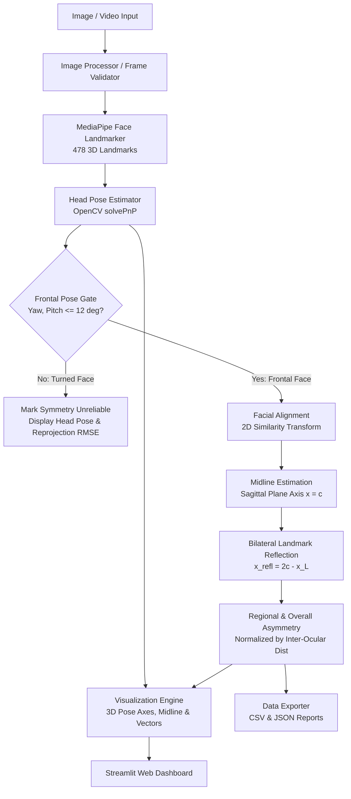

# FaceScope — Face Posture and Facial Symmetry Analyzer

FaceScope is an end-to-end, locally-executed computer vision system designed to quantify 3D facial posture (yaw, pitch, roll) and bilateral geometric facial symmetry using dense 478-point facial mesh landmarks.

---

## 1. Project Overview

FaceScope provides an objective, transparent, and reproducible pipeline for analyzing head orientation and facial geometry from images and video sequences. It combines **Google MediaPipe's dense facial mesh topology** with **OpenCV's perspective-n-point (solvePnP) algorithm** and **2D similarity transform alignment**.

### ⚠️ Non-Medical Notice & Disclaimer
> **IMPORTANT**: FaceScope is strictly a computer vision and geometry analysis tool designed for software engineering and computer vision research. It measures Euclidean landmark coordinates and pixel distances. It is **NOT** a medical diagnostic instrument, orthodontic assessment tool, or measure of personal attractiveness.

---

## 2. Key Features

- **Dense Facial Landmark Extraction**: Real-time extraction of 478 3D landmarks (468 facial mesh + 10 iris tracking points) via MediaPipe Face Landmarker.
- **3D Head Pose Estimation (`solvePnP`)**:
  - Pinhole camera intrinsic modeling with zero-distortion assumption.
  - Standardized anthropometric 3D reference facial model.
  - Levenberg-Marquardt optimization returning Euler angles (Yaw, Pitch, Roll in degrees).
  - Reprojection error (RMSE in pixels) calculated for quality assurance.
- **Frontal Pose Suitability Gating**:
  - Automatically identifies non-frontal head poses ($|\text{yaw}| > 12^\circ$ or $|\text{pitch}| > 12^\circ$).
  - Prevents erroneous symmetry scores caused by 3D perspective foreshortening.
- **2D Similarity Alignment**:
  - Normalizes translation, in-plane roll tilt, and scale.
  - Inter-ocular distance normalization ($D_{ref} = 100.0$ canonical units).
- **Geometric Bilateral Symmetry Analysis**:
  - Robust facial midline axis estimation ($x = c$) from anatomical sagittal landmarks.
  - Mathematical point reflection across the midline: $x_{refl} = 2c - x_L$.
  - Regional Euclidean discrepancies across eyes, eyebrows, cheeks, mouth, and jawline.
  - Transparent heuristic display score ($0 - 100\%$).
- **Temporal Video Analysis**:
  - Exponential Moving Average (EMA) smoothing for yaw, pitch, and roll.
  - Frame-by-frame measurement tracking, time-series plotting, and annotated video export.
- **Streamlit Web Dashboard**:
  - Side-by-side original and annotated displays.
  - Real-time 3D coordinate axes protruding from the nose tip.
  - Matplotlib regional asymmetry bar and time-series charts.
  - Downloadable CSV metrics and JSON reports.

---

## 3. Technology Stack

- **Python**: 3.10 / 3.11
- **Landmark Detection**: Google MediaPipe (Tasks API `FaceLandmarker`)
- **Computer Vision & Geometry**: OpenCV (`opencv-python` $\ge$ 4.8)
- **Numerical Computations**: NumPy ($\ge$ 1.24, < 2.0) & SciPy ($\ge$ 1.10)
- **Data Structuring & Export**: Pandas ($\ge$ 2.0)
- **Visualization**: Matplotlib ($\ge$ 3.7)
- **Interactive UI**: Streamlit ($\ge$ 1.30)
- **Automated Testing**: Pytest ($\ge$ 7.4)

---

## 4. Architecture Diagram



---

## 5. Directory Structure

```
face-scope/
├── app.py                      # Streamlit interactive dashboard
├── requirements.txt            # Pinned dependency specifications
├── pytest.ini                  # Pytest path and runner configuration
├── README.md                   # System documentation & usage guide
├── VALIDATION_REPORT.md        # Validation methodology & test results
├── .env.example                # Configurable threshold overrides
├── .gitignore                  # Git tracking rules
├── models/
│   ├── README.md               # Model details & official source URLs
│   └── face_landmarker.task    # Google MediaPipe Face Landmarker model (Float16)
├── src/
│   ├── __init__.py
│   ├── config.py               # Topologies, 3D model, weights, thresholds
│   ├── model_loader.py         # Model verification & auto-download
│   ├── image_processor.py      # Input validation, decoding & color transforms
│   ├── landmarks.py            # Landmark detection & regional grouping
│   ├── head_pose.py            # solvePnP pose & Euler angle conversion
│   ├── face_alignment.py       # 2D similarity transform & pose gating
│   ├── symmetry.py             # Bilateral reflection & asymmetry scoring
│   ├── visualization.py        # 3D axes, midline, pairs & charts
│   ├── video_processor.py      # Video frame processing & EMA smoothing
│   └── export_utils.py         # CSV and JSON report serialization
├── tests/
│   ├── test_landmarks.py       # Landmark property & indexing tests
│   ├── test_head_pose.py       # solvePnP synthetic projection tests
│   ├── test_face_alignment.py  # Translation/scale invariance & gating tests
│   ├── test_symmetry.py        # Perfect & asymmetric synthetic face tests
│   ├── test_exports.py         # CSV & JSON export validation
│   └── test_integration.py     # End-to-end real image & video tests
├── data/
│   ├── README.md
│   └── sample_images/
│       ├── frontal_neutral.jpg # Sample neutral frontal portrait
│       └── turned_pose.jpg     # Sample turned angled portrait
└── outputs/
    └── .gitkeep                # Export directory for processed files
```

---

## 6. Installation & Setup

### Prerequisites
- Python 3.10 (recommended) or 3.11.

### Step 1: Clone Repository & Create Virtual Environment

**Windows (PowerShell):**
```powershell
# Navigate to project directory
cd face-scope

# Create virtual environment using Python 3.10
py -3.10 -m venv .venv

# Activate virtual environment
.\.venv\Scripts\Activate.ps1
```

**macOS / Linux:**
```bash
cd face-scope
python3.10 -m venv .venv
source .venv/bin/activate
```

### Step 2: Install Dependencies
```bash
pip install --upgrade pip
pip install -r requirements.txt
```

### Step 3: Model Verification & Download
FaceScope automatically downloads the official Google MediaPipe `face_landmarker.task` model file on first launch if it is missing.

To verify or manually download:
```bash
python -c "from src.model_loader import download_model_if_missing; download_model_if_missing()"
```
- **Official Source**: `https://storage.googleapis.com/mediapipe-models/face_landmarker/face_landmarker/float16/latest/face_landmarker.task`
- **Destination**: `models/face_landmarker.task` (size: ~3.7 MB)

---

## 7. Running the Application

### Launch Streamlit Dashboard
```bash
streamlit run app.py
```
Open your browser to `http://localhost:8501`.

The dashboard features:
1. **Overview**: Project principles, methodology, and disclaimers.
2. **Image Analysis**:
   - Upload any custom portrait (JPG, PNG, WEBP) or test immediately with built-in sample images (`frontal_neutral.jpg` and `turned_pose.jpg`).
   - Side-by-side original and annotated visualization.
   - Numerical Yaw, Pitch, Roll gauges with 3D coordinate axes overlay.
   - Regional symmetry error breakdown (% of inter-ocular distance).
   - One-click CSV, JSON, and annotated JPEG image downloads.
3. **Video Analysis**:
   - Upload video clips (MP4, AVI, MOV).
   - Configurable frame stride and EMA smoothing factor.
   - Temporal head angle dynamics and regional asymmetry time-series charts.
   - Export frame-by-frame metrics to CSV.
4. **Methodology**: Detailed mathematical formulation and technical explanations.
5. **About**: Stack details and privacy commitments.

---

## 8. Running Automated Tests

Run the full automated test suite (unit and integration tests) using Pytest:

```bash
pytest -v
```

To run only mathematical algorithm unit tests (no model dependency):
```bash
pytest -v tests/test_landmarks.py tests/test_head_pose.py tests/test_face_alignment.py tests/test_symmetry.py tests/test_exports.py
```

To run integration tests on real sample images and video:
```bash
pytest -v tests/test_integration.py
```

---

## 9. Mathematical Formulation & Conventions

### Head Pose Conventions
- **Camera Frame**: Standard OpenCV camera coordinate system:
  - $+X$: Rightward
  - $+Y$: Downward
  - $+Z$: Away from camera into the scene
- **Yaw (rotation about $Y$)**:
  - $0^\circ$: Frontal
  - Positive: Face turned to subject's left (viewer's right)
  - Negative: Face turned to subject's right (viewer's left)
- **Pitch (rotation about $X$)**:
  - Positive: Looking downward
  - Negative: Looking upward
- **Roll (rotation about $Z$)**:
  - Positive: Tilting head toward subject's right shoulder

### Geometric Symmetry Formulation
1. **Midline Axis**: Robust median of central sagittal landmarks (pronasale, nasion, philtrum, gnathion): $x = c$.
2. **Bilateral Reflection**: For point $L = (x_L, y_L)$:
   $$x_{refl} = 2c - x_L, \quad y_{refl} = y_L$$
3. **Euclidean Discrepancy**:
   $$E_i = \sqrt{(x_{refl} - x_R)^2 + (y_L - y_R)^2}$$
4. **Scale Normalization**:
   $$\tilde{E}_i = \frac{E_i}{D_{ref}}$$
   where $D_{ref}$ is the inter-ocular distance between eye centroids.
5. **Heuristic Symmetry Score**:
   $$S = 100 \cdot \exp(-5.0 \cdot \tilde{E}_{overall})$$
   Strictly bounded within $[0.0, 100.0]\%$.

---

## 10. Privacy & Security Safeguards

- **100% Local Execution**: All neural inference and geometry processing execute strictly within the local environment. No data is transmitted to external servers.
- **Safe Resource Cleanup**: Temporary video files and uploaded buffers are automatically unlinked and released upon completion.
- **No PII Logging**: FaceScope does not store or log biometric identifiers or images without explicit user request.

---

## 11. Known Limitations & Potential Future Work

- **Lighting & Shadow Asymmetry**: Extreme directional side-lighting can create cast shadows that subtly shift 2D landmark detector confidence.
- **Facial Expressions**: Facial action units (smiling, squinting, talking) introduce dynamic asymmetry. Future work could include neutral expression verification.
- **3D Full Mesh Morphable Models (3DMM)**: Integrating non-rigid 3D reconstruction could allow non-frontal pose rectification beyond 2D similarity alignment.
